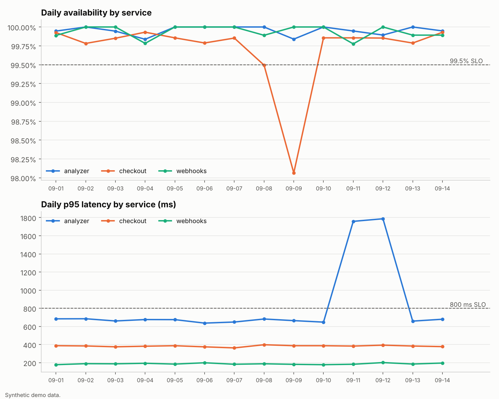

# SLO Telemetry Warehouse

A product-owned data pipeline that turns raw service logs into reliability metrics a whole team can trust: **validated, de-duplicated events in a star-schema warehouse, SLIs and error budgets in SQL, burn-rate alerts that page only for real incidents, and exports for Power BI or Tableau.**

It's delivered the way a technical product owner runs a product: a [product brief](docs/product_brief.md), a [WSJF-prioritized backlog](docs/backlog.md) of features, NFRs, tech debt and spikes, [user stories with acceptance criteria](docs/user_stories.md) that map one-to-one to automated tests, and a [data dictionary](docs/data_dictionary.md).



## What it found (14 days of synthetic logs, 3 services)

| Signal | Result |
|---|---|
| Data quality | 59,797 log lines → **58,372 unique events**; 1,149 duplicate deliveries skipped; 276 malformed lines quarantined with a reason |
| Idempotency | Re-running the same load inserted **0** rows |
| Availability incident | checkout dropped to 98.1% on Sept 9; **3 page-severity alerts**, exactly the incident hours (15:00–17:00 UTC) |
| Latency regression | analyzer p95 reached **1,787 ms** vs an 800 ms SLO on Sept 11–12 |
| Error budget | All services within budget for the period (checkout used 59%, the most) |
| Alert quality | Without a minimum-volume guard, 17 hours would have paged; with it, only the 3 real incident hours did |

Full output: [reports/slo_report.md](reports/slo_report.md) · BI-ready tables: [exports/](exports)

## Architecture

```
JSON log lines ──► validate against log contract ──► quarantine (reason per bad line)
                          │
                          ▼
             idempotent load on event_id ──► star schema ──► SLI / SLO SQL ──► report.md, chart
             (load_audit row per run)        fact_request                       exports/*.csv → Power BI / Tableau
                                             dim_service, dim_endpoint, dim_date, slo_target
```

- **Warehouse SQL** runs on SQLite locally and in CI ([schema](sql/schema.sql), [SLI queries](sql/sli_queries.sql)), using window functions for p95.
- **Snowflake** DDL and a `MERGE`-based load ([sql/snowflake/](sql/snowflake)) mirror the same logic for deployment, with `QUALIFY` de-duplication and `TRY_TO_NUMBER` validation.
- **Log contract** follows OpenTelemetry-style fields (`trace_id`, service, endpoint, status, duration).

## Run it

Python 3.10+ standard library only (matplotlib optional, for the chart).

```bash
python data/generate_logs.py        # 14 days of synthetic logs with an incident, duplicates and bad lines
python -m pipeline.ingest           # load into warehouse.db (run it twice: second run inserts 0)
python -m pipeline.report           # reports/slo_report.md, reports/slo_dashboard.png, exports/*.csv
python -m unittest -v               # 10 acceptance tests, one per acceptance criterion
```

Or with Docker: `docker build -t slo-telemetry-warehouse . && docker run --rm slo-telemetry-warehouse`

## Product decisions

- **Quarantine, never drop.** Bad lines are kept with a reason so data issues are visible and fixable upstream.
- **Natural-key idempotency.** `event_id` is the fact table's primary key, so retried log shipping can't inflate counts.
- **Alert on customer impact.** Burn-rate alerts need at least 3 bad requests in the hour; pages at ≥14.4×, tickets at ≥6×. This came from the first real run (see the [decisions log](docs/backlog.md#decisions-log)).

## Limits

- Logs are synthetic; the Snowflake scripts are written but not executed in CI.
- Burn rates use 1-hour windows only; multiwindow (5-minute + 1-hour) alerting is the next backlog item (PB-12).
- Batch loading only; streaming ingest is a scoped spike (PB-14).
